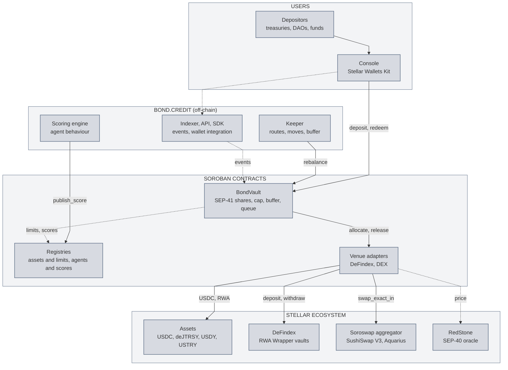
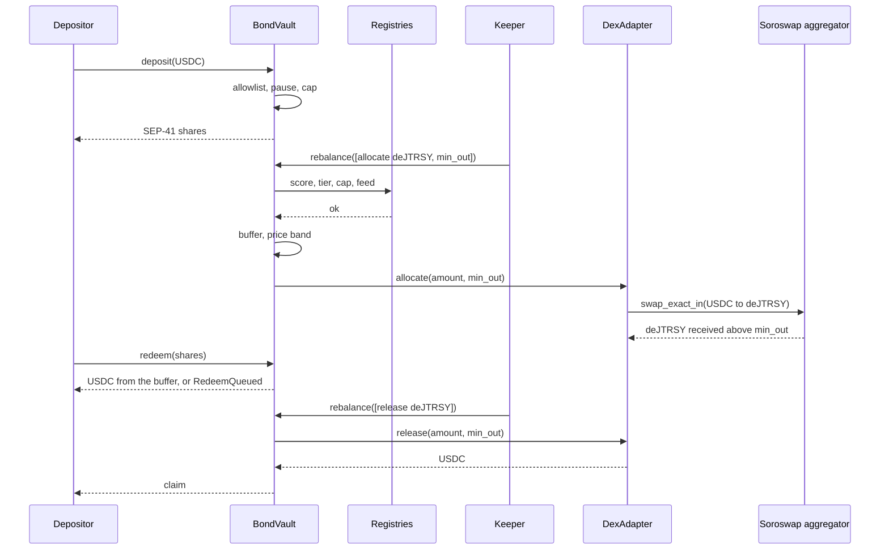

# Technical architecture: the bond.credit RWA vault on Stellar

**Product:** a USDC vault on Soroban whose RWA positions are driven by an agent, within limits the contracts enforce. **Depositors:** stablecoin treasuries, DAOs and small funds, non-US and non-UK, by invitation at launch. **Operator:** Liminal Space Labs, Inc. (bond.credit). The code is public: [github.com/bond-dot-credit/bond-stellar](https://github.com/bond-dot-credit/bond-stellar); the vault, the keeper and the console run there on testnet.

---

## 1. One page

Since 2025 we have been scoring third-party DeFi agents on what they actually do on-chain and allocating capital to the best-scored ones, under caps, on Ethereum, Base and Arbitrum. On Stellar we are building what that model lacks: a vault whose limits are written into the contract, so that an agent cannot exceed them even if it is compromised.

A depositor brings USDC and receives shares, a standard token they can transfer. An agent, the **keeper**, puts that USDC into approved Stellar RWAs and brings it back when withdrawals need paying. Before every move, the vault checks two registries: the **asset registry** (which assets are allowed, through which venue, up to what amount, with what price deviation tolerated) and the **agent registry** (which agent may drive, up to what amount, based on its score). If a rule is not met, the move fails and the failure is visible on-chain. Withdrawals are paid first from a buffer of USDC kept liquid, then through a queue the keeper drains by selling positions. Deposits can be paused; withdrawals never.

Two venues at launch: the **DeFindex** "RWA Wrapper" vaults (USDY, USTRY) and direct purchase of **deJTRSY** (Janus Henderson via Centrifuge) through the **Soroswap** aggregator, which splits the order between SushiSwap V3 and Aquarius. Every position is valued at a SEP-40 oracle price (RedStone), and no trade executes at a price too far from that oracle price. That is our protection against the main risk of an RWA vault on Stellar: shallow pools whose price can be moved cheaply.

An agent's score measures its **behaviour**, not its return: does it do better or worse than a passive position on the same assets, how many of its moves did the vault reject, does it keep the buffer topped up, does it exit in time when liquidity drops, how much do its trades cost. At launch a single agent is scored, our own; the registry can take others.

**What Stellar gets out of it:** USDC deposited into Soroban, Stellar RWAs actually held and traded on the DEXes, a regular and bounded buyer for those assets, and agent scores published on-chain, readable by any other protocol.

## 2. Components

| Component | Role | Status |
| --- | --- | --- |
| **BondVault** (Soroban) | SEP-56 tokenized vault: USDC in, SEP-41 shares out; cap, buffer, deposit pause, allowlist, withdrawal queue, execution of keeper moves under registry control | On testnet, to be rebuilt on the OpenZeppelin library |
| **AssetRegistry** (Soroban) | List of approved assets: venue, adapter, per-asset cap, price feed, tolerated deviation, freshness | To build |
| **AgentRegistry** (Soroban) | Score and allocation tier of each agent, written by our scoring engine, read by the vault on every move | To build |
| **DeFindexAdapter** (Soroban) | Venue: deposit into and withdrawal from a DeFindex RWA Wrapper vault, valuation of the position | To build |
| **DexAdapter** (Soroban) | Venue: buying and selling deJTRSY through the Soroswap aggregator, minimum output derived from the oracle | To build |
| **Keeper** (off-chain) | Our agent: computes routes, proposes moves, holds the buffer; one key, three functions | On testnet, to extend |
| **Scoring engine** (off-chain) | Scores agents on their behaviour and publishes the score to AgentRegistry | Exists (EVM), to connect to Stellar |
| **Console** | Stellar Wallets Kit, deposit and withdrawal, NAV, log of accepted and rejected moves, admin pages | On testnet, to complete |
| **Indexer, API and SDK** | Vault events in a database, REST API and `@bond.credit/sdk` package so a wallet or app can offer the vault to its users | To build |
| **Stellar assets** | USDC (Circle), deJTRSY (Centrifuge), USDY (Ondo), USTRY (Etherfuse), through their Stellar Asset Contract | Exist |
| **DeFindex, Soroswap, RedStone** | Yield vaults, swap aggregator, SEP-40 oracle | Exist |

## 3. Overview

## 4. Design principles

1. **The keeper proposes, the contract decides.** The keeper picks the moves; the vault accepts or rejects them. Even holding the keeper's key, an attacker can neither send USDC to a third-party address, nor exceed a cap, nor trade at a price outside the band, nor dip into the buffer: all four are refused by the contract.
2. **We only write what is ours.** Shares are the SEP-56 tokenized vault from the OpenZeppelin `stellar-tokens` library (version 0.8.0), hence a complete SEP-41 token we do not rewrite. Our code is the policy: buffer, withdrawal queue, allowlist, registries, adapters.
3. **One question per move, three answers.** "May this agent move this amount, on this asset, at this price?" AssetRegistry answers for the asset, AgentRegistry for the agent, the oracle for the price. All three answers are obtained in the same transaction as the move: if any one is no, nothing moves.
4. **A withdrawal is never blocked.** It is paid from the buffer right away, otherwise queued and paid once the keeper has sold positions. Pausing stops deposits and keeper moves, not withdrawals. If the agent fails, the administrator replaces it in one transaction; positions do not move.
5. **We never buy more than the market can buy back from us.** Each asset's cap is set from the measured depth of its pools and remeasured before every cap increase; every trade has a minimum amount to receive computed from the oracle price. The pool attacked on Stellar in February 2026 read an asset's price from an empty market; that is what our depth-sized caps and oracle valuation prevent.

## 5. BondVault

### 5.1 Shares and accounting

BondVault implements `FungibleVault` (SEP-56) and `FungibleToken` (SEP-41) from OpenZeppelin `stellar-tokens`, with `TotalSupply` and `Capped`. The underlying asset is Circle's USDC (issuer `GA5ZSEJYB37JRC5AVCIA5MOP4RHTM335X2KGX3IHOJAPP5RE34K4KZVN`, called through its Stellar Asset Contract). The vault's decimals offset is set to 6: the equivalent of a million virtual shares already issued, which makes the first-depositor attack (inflating the share price to rob the second depositor) unprofitable, as the virtual offset of the testnet prototype already did. `total_assets`, which sets the value of a share, is overridden through `VaultOverrides`: the USDC held by the vault, plus the value of the positions returned by each adapter (`value_of`), minus the queued withdrawals already provisioned.

Shares transfer freely; the right to redeem follows the share, not the address. The allowlist applies to **depositing** (putting USDC into the vault), not to holding: someone who has received shares can redeem them. The contract reads USDC's decimals at initialization and never assumes them.

### 5.2 Functions

| Function | Who | What it does |
| --- | --- | --- |
| `deposit(assets, receiver, from, operator)` | allowlisted depositor | `from.require_auth()`, deposits not paused, `total_assets + assets ≤ cap`, shares minted to `receiver` |
| `redeem(shares, receiver, owner, operator)` | any holder | shares burned, USDC paid from the buffer if sufficient; otherwise `RedeemQueued` and the shares are locked in the queue |
| `claim(owner)` | queued holder | pays a provisioned request, in queue order |
| `rebalance(moves)` | registered agent | list of moves `(adapter, direction, amount, min_out)`; each move passes the checks of §5.3 or the whole transaction fails |
| `set_cap`, `set_buffer_bps`, `set_paused`, `set_agent`, `set_allowlisted`, `set_registry` | administrator | configuration; `set_agent` replaces the agent without touching positions |
| `preview_*`, `convert_to_*`, `max_*`, `total_assets`, `idle`, `queue` | read | standard SEP-56, plus buffer and queue state |

### 5.3 Checks on a keeper move

In order, for each move: (1) the caller is the registered agent and its score in AgentRegistry is above the threshold; (2) the target adapter is the one AssetRegistry associates with an approved, non-suspended asset; (3) after the move, the position in the asset stays under the asset's cap and the total allocated under the agent's tier; (4) the USDC left in the vault covers the target buffer (a share of `total_assets`, 20 % at launch) and the pending withdrawal queue; (5) the asset's oracle price is not stale; (6) the keeper's `min_out` is at least the one the vault computes itself from the oracle price and the tolerated deviation; the stricter of the two applies. A rejected move emits `MoveRejected(agent, adapter, reason)` and fails the whole transaction: the keeper cannot "try quietly", every rejected attempt is public.

### 5.4 Withdrawal queue

When the buffer is not enough, `redeem` records the request (shares locked, amount fixed at that moment's NAV) and emits `RedeemQueued`. The keeper sees the queue and frees USDC through the adapters (selling deJTRSY, withdrawing from DeFindex). As soon as the USDC is there, requests are provisioned in order, and each holder calls `claim`. If DEX liquidity is degraded, the queue drains more slowly, at the pace of what is freed; we never promise an "instant" redemption. Target: a request paid within 24 hours; the console shows the actual delay.

### 5.5 Roles, pause, upgrade

The administrator is a multisignature Stellar account (two signatures out of three for routine operations, a higher threshold to change signers), never a single key. OpenZeppelin's `Pausable` (`#[when_not_paused]`) protects `deposit` and `rebalance`; `redeem` and `claim` are not subject to it. The contract is `Upgradeable` (OpenZeppelin `stellar-contract-utils`) and the upgrade authority is a `timelock-controller` (OpenZeppelin `stellar-governance`) driven by the administrator: a code change is announced, then takes effect only 48 hours later, which leaves a depositor time to exit if they disagree. The storage schema is versioned and error codes are never renumbered. Initialization through `__constructor`, not an `initialize` function: nobody can re-initialize the vault afterwards.

### 5.6 Storage

Configuration and addresses in `instance`; share balances (managed by the library), allowlist and withdrawal queue in `persistent`, typed keys `Allowlisted(Address)`, `Queued(u64)`. On Soroban, an entry whose time to live (TTL) expires is archived: we extend the TTL on every write and at the top of every entry point. No per-user data in `instance`, so the contract's footprint does not grow with the number of depositors. Deadlines (queue, price freshness) are stored in the values and checked by code: the TTL is never used as a security rule.

## 6. Registries

### 6.1 AssetRegistry: the per-asset limits

One entry per approved asset:

| Field | Meaning |
| --- | --- |
| `asset` | address of the Stellar Asset Contract (deJTRSY, USDY, USTRY) |
| `adapter` | venue contract authorized for this asset |
| `cap` | position cap in USDC, sized on pool depth |
| `feed` | SEP-40 oracle contract and feed identifier |
| `max_deviation_bps` | maximum gap between execution price and oracle price |
| `max_age` | maximum age of the oracle price, in seconds |
| `enabled` | a suspended asset receives no more purchases; sales remain possible |

Only the administrator writes to this registry, and every change emits an event. Before approving an asset, we run a checklist published in our documentation (issuer terms, redemption terms, market depth, contract risk, concentration); the cap and tolerated deviation recorded here are its numerical result.

### 6.2 AgentRegistry: who may drive

One entry per agent: `score` (0 to 1,000), `tier` (maximum amount it may allocate, in USDC), `updated_at`, `publisher`. Our scoring engine writes through `publish_score(agent, score, tier)`, with a publishing key distinct from the administrator's and the agent's. Below `min_score`, `rebalance` is refused at the first check, with no human intervention. A score older than `max_age` counts as zero: a scoring engine that is down blocks the agent instead of letting it run on an old score. The registry exposes `score_of(agent)` and `tier_of(agent)` to any contract: another Stellar vault can use them.

### 6.3 The score measures behaviour

On Treasuries, the return comes almost entirely from the underlying; scoring an agent on its return would distinguish nothing. So the score rates what the agent does: the gap between the vault's NAV and a passive position (same assets, same caps, no moves); the number of moves rejected by the vault (`MoveRejected`); how well it holds the buffer and how fast it pays the queue; the cumulative cost of trades (gap between execution price and oracle price); early exits when a pool's depth drops. All these inputs are public vault events: a third party can recompute the score and check ours.

## 7. Venues and adapters

Both adapters share the same interface: `allocate(amount, min_out)` allocates, `release(amount, min_out)` withdraws, `value_of()` says what the position is worth, `asset()` says which asset is held. Only the vault can call them (the vault's `require_auth` at the top of every function). An adapter owns nothing for its own account: the position is in the vault's name or the adapter's depending on what the venue requires, and `value_of` is always computed at the oracle price of §8, never at the DEX price.

### 7.1 DeFindexAdapter (USDY, USTRY)

The DeFindex vaults that carry the "RWA Wrapper" strategy already convert USDC into a tokenized bond and back, with their own dual pricing and their own caps, one contract per asset, withdrawals never paused: we do not redo that work. The adapter calls `deposit(amounts_desired, amounts_min, from, invest)` and `withdraw(withdraw_shares, min_amounts_out, from)` on the target DeFindex vault. Since the DeFindex vault pulls the USDC itself, one level below our call, the adapter authorizes that pull through `authorize_as_current_contract`. The position is a balance of dfTokens (the DeFindex vault's shares); `value_of` converts it at the DeFindex vault's NAV, then caps it by the oracle price of the underlying asset. Two adapters are deployed at launch, one per DeFindex vault (USDY, USTRY).

### 7.2 DexAdapter (deJTRSY)

deJTRSY is a transferable note without allowlist (identity verification only at issuance and redemption with the issuer), whose Stellar liquidity sits on SushiSwap V3 and, in part, on Aquarius. The adapter buys and sells through the Soroswap aggregator: `swap_exact_in(user, token_in, amount_in, token_out, min_out, routes, partner_option)`, where `routes` is the split between pools computed off-chain by the keeper, from Soroswap's quote API, less than 180 seconds before submission. The vault recomputes `min_out` from the oracle price and the tolerated deviation before accepting the move: the keeper's route can therefore return more than the band, never less. The adapter authorizes the pull through `authorize_as_current_contract`. The position is the adapter's deJTRSY balance; `value_of` = balance × oracle price.

### 7.3 Adding a venue

One more venue (deJAAA, an Etherfuse stablebond, another DeFindex vault) needs one more adapter, one more entry in AssetRegistry, and a cap measured on its market. The vault does not change.

## 8. Prices, valuation and execution band

- **Price source**: RedStone SEP-40 feeds for deJTRSY, deJAAA, USDY and USTRY (published on Stellar since August 2026), read through `lastprice`. Every price is checked: right decimals, `price > 0`, under an upper plausibility bound, no older than `max_age` (1 hour at launch). A stale price blocks deposits and moves; withdrawals from the buffer continue, at the last valid NAV.
- **Valuation**: every position is valued at the oracle price, not the DEX price. A trade on a thin pool therefore cannot inflate the NAV.
- **Execution band**: for every trade, the vault computes `min_out = amount_in × oracle_price × (1 − max_deviation_bps)`. If a pool is manipulated, the trade fails; the vault loses no money.
- **Caps from depth**: an asset's cap is a fraction of the measured liquidity of its pools at a reference trade size; the measurement is redone before every increase of the vault's cap and published in our documentation.
- **Fallback**: if RedStone drops an asset's feed, the asset is suspended in AssetRegistry (sales possible, purchases not) and the keeper reduces the position.

## 9. The keeper

A Node service (Stellar SDK v16, Node 22), already written for the testnet prototype, extended to both venues. On every cycle it reads the withdrawal queue, the buffer, the positions and the caps; requests quotes from the Soroswap API; builds a list of moves; simulates it; submits `rebalance`; handles the `PENDING`, `TRY_AGAIN_LATER` and `DUPLICATE` statuses per the RPC procedure, and calls `getTransaction` before concluding a failure. The keeper's key has one right: calling `rebalance`. It holds no USDC and can sign no transfer. It lives in a secrets manager, with documented rotation; `set_agent` by the administrator replaces it in one transaction. The keeper keeps a log of every move proposed, accepted or rejected, which feeds the scoring engine.

## 10. Flows

### 10.1 Deposit, allocation, withdrawal

### 10.2 Failing agent

The scoring engine publishes a score below the threshold, or the administrator suspends the agent: the next `rebalance` fails at the first check, with an event. Positions keep their oracle value and withdrawals continue, from the buffer then through the queue, paid by a replacement agent registered through `set_agent`. No agent key can ever receive USDC.

### 10.3 Asset frozen or suspended by the issuer

The issuers of these assets can freeze an address or revoke a trustline's authorization. If the adapter's address is frozen, `release` fails, the asset is suspended in AssetRegistry, the position stays valued at the oracle price and the console shows it as illiquid; the other assets keep paying the queue. We only hold assets whose issuer publishes its terms and accepts contract holders, and we have a verified entity (KYB) with the issuer to request a direct redemption if a position had to be unwound off-DEX.

## 11. Console, indexer, API and SDK

- **Console**: Stellar Wallets Kit v2 (Freighter, xBull, Albedo, LOBSTR, WalletConnect). Before every signature, the console checks the network and the account, simulates the transaction and shows what is about to happen. Pages: deposit and withdrawal with share preview, NAV and composition by asset, buffer and queue state, log of accepted and rejected moves, admin pages reserved for signers.
- **Indexer**: vault and registry events (`Deposit`, `Withdraw`, `RedeemQueued`, `MoveExecuted`, `MoveRejected`, `ScorePublished`, configuration changes) are read through `getEvents` on Stellar RPC and stored in a database. The RPC keeps only about seven days of history: the indexer runs continuously and, after an outage, backfills from public history (SEP-54 data lake or Galexie). The NAV and history shown by the console and the API come from this database, which contains only what the chain emitted.
- **API and SDK**: a REST API (one key per integrator, idempotent calls, webhooks on deposit, withdrawal and NAV update) and a TypeScript package `@bond.credit/sdk` that builds the `deposit`, `redeem` and `claim` transactions, which the end user signs in their own wallet, and reads previews and NAV. The integrator never touches funds. This is what lets a wallet or a payment app on Stellar offer "save in USDC" without building a console.

## 12. Why Stellar

Stellar carries several billion dollars of tokenized real-world assets, yet almost none of that value circulates in its DeFi. The building blocks already exist: assets transferable without allowlist (deJTRSY, deJAAA, USDY, Etherfuse stablebonds), venues (DeFindex, Soroswap, SushiSwap, Aquarius), prices (RedStone, SEP-40). What is missing is a buyer that buys regularly, within written limits, and whose every move can be verified. Soroban lets us write those limits into the contract: a keeper cannot get an authorization executed that it does not hold (explicit authorization trees); the check and the move succeed or fail together (atomic cross-contract calls); fees are low enough to rebalance often. And Circle's USDC is native on Stellar, with no bridge.

## 13. Business model

The vault takes a performance fee on realized yield, paid in shares to a fee address, capped in the contract and shown in the console. Nothing on capital, no entry or exit fee at the vault level (the venues' swap fees remain the venues'). A wallet or app that brings deposits through the API receives a share of that fee on those deposits. Reading the score registry is free; publishing scores for third-party agents will become a paid service once other agents are scored.

## 14. Legal structure and link to the assets

The operator is Liminal Space Labs, Inc. (Delaware), which runs bond.credit. The vault holds assets issued by third parties: deJTRSY is a Centrifuge Reg S note backed by a Janus Henderson Treasuries fund, closed to US persons; USDY and the Etherfuse stablebonds have their own jurisdiction restrictions. Depositors are admitted by invitation, outside the United States and the United Kingdom, after we have verified their jurisdiction; the on-chain allowlist is the record of it. The vault issues no new stablecoin and promises no yield: a share is worth a fraction of a basket of USDC and approved assets, valued at the oracle. The issuers' terms for secondary holders are carried over into our documentation and into the asset approval checklist.

## 15. Trust boundaries and failure modes

| What fails | Effect | Response |
| --- | --- | --- |
| Keeper offline | No allocation; the queue fills up | Alert; replacement agent; withdrawals from the buffer |
| Keeper compromised | Attempts out-of-bounds moves | Refused by the contract; `set_agent`; score to zero |
| Stale oracle | Deposits and moves blocked | Withdrawals from the buffer at the last NAV; asset suspended if lasting |
| DEX pool drained or manipulated | Out-of-band trades impossible | Queue served more slowly; cap revised downwards |
| DeFindex venue paused | Withdrawals from that venue impossible | Asset suspended; the other venues serve the queue |
| Address frozen by an issuer | Illiquid position | Marked at the oracle; primary redemption through our verified entity |
| Admin key lost | No more configuration | 2-of-3 multisig; signer recovery procedure |

### STRIDE threat model

| Category | Threat | Mitigation |
| --- | --- | --- |
| **Spoofing** | A third party impersonates the agent or the score publisher | `require_auth` on the address loaded from storage, never from an argument; distinct agent, publisher and admin keys |
| **Spoofing** | A contract mimics a venue's interface | Adapters and venues allowlisted in AssetRegistry by the administrator |
| **Tampering** | Re-initialization of the vault | `__constructor`, no `initialize` |
| **Tampering** | Share dilution by the first depositor | Decimals offset of the OpenZeppelin vault |
| **Tampering** | Trade executed at a manipulated price | `min_out` derived from the oracle, `max_deviation_bps`, NAV marked at the oracle |
| **Tampering** | Negative amounts, overflows | OpenZeppelin library, `checked_*`, `overflow-checks` in release |
| **Repudiation** | A move or configuration change without a trace | Events on every state change; SEP-55 verified build linking the on-chain hash to the commit |
| **Information disclosure** | Depositors' personal data | Nothing on-chain beyond addresses; supporting documents stay off-chain |
| **Denial of service** | Unbounded loop over the withdrawal queue | `claim` handles one request; `rebalance` bounded to 8 moves; queue indexed by sequence |
| **Denial of service** | Venue that exhausts the execution budget | Allowlisted venues; `try_` does not catch budget exhaustion, so an asset that causes it is suspended |
| **Denial of service** | Archived storage entries | TTL extended on every write; automatic restoration of persistent entries in the footprint; TTL monitoring |
| **Elevation of privilege** | Unprotected upgrade | `Upgradeable` with `_require_auth` on the multisig administrator, 48-hour delay |
| **Elevation of privilege** | Single admin | Multisignature account, distinct medium and high thresholds, pause and incident procedure |

What the platform rules out by itself: no `delegatecall`, no reentrancy on normal paths, authorization replay protection handled by the host.

### Monitoring plan

OpenZeppelin Monitor listens to vault and registry events and alerts on: repeated `MoveRejected`, a buffer below target, a request queued for more than 24 hours, an oracle price older than `max_age`, a gap between the oracle NAV and execution prices, a configuration change, a critical entry's TTL close to expiry. Written incident procedure: deposit pause, agent replacement, asset suspension, key rotation, communication to depositors.

## 16. Testing and deployment

- **Versions**: `soroban-sdk` 29 (protocol 29, mainnet November 2026), `stellar contract build` with CLI 28, `wasm32v1-none` target, OpenZeppelin `stellar-contracts` 0.8.0 pinned.
- **Tests**: unit tests with asserted authorizations (`env.auths()` on `rebalance` and the adapters), one negative test per check of §5.3, fuzzing and property tests on share accounting and the queue, versioned test snapshots, mutation testing, Scout (CoinFabrik) static analysis and OpenZeppelin Security Detectors in CI.
- **Fork tests**: `stellar snapshot create` copies the mainnet state of the DeFindex vaults, the Soroswap aggregator and the deJTRSY pools, to test the adapters against the real contracts before any deployment.
- **Testnet**: replayable deployment scripts (testnet is reset every quarter); since deJTRSY has no testnet version, a test token and a pool we seed stand in for it for the DexAdapter; the DeFindexAdapter is tested on the testnet DeFindex vaults when they exist, otherwise in fork.
- **Before production**: SEP-55 verified build (`source_repo` and `home_domain` metadata, GitHub attestation, deployment of the WASM attached to the release), multisig administrator account in place, incident procedure rehearsed on testnet, low launch cap then raised in steps after each liquidity measurement.

## 17. Scope and future work

**In scope**: BondVault, AssetRegistry, AgentRegistry, DeFindexAdapter (USDY, USTRY), DexAdapter (deJTRSY via Soroswap), keeper, scoring engine connected to Stellar, console, indexer, API and SDK; one scored agent at launch.

**Out of scope, planned next**: deJAAA and the Etherfuse stablebonds as new registry entries; direct redemption with the issuer as a second exit route; USDC inflows from other chains through CCTP; embedded wallets (Privy) in the console; several vaults by risk profile; scoring of third-party agents in AgentRegistry.

**Out of scope, not planned**: a new stablecoin; permissioned assets that would require the issuer to approve the vault's address; non-dollar assets; an agent whose reasoning would run on-chain.
